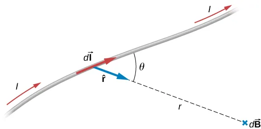

# Learning notes

Newest at top.

---

## Rig block diagram: what the arrows mean (2026-11-20)
 

 
- **USB serial** = text back & forth over the USB cable, like a chat
  - Laptop sends `read` → microcontroller replies Bx, By, Bz
- **I²C** = 2-wire chip-to-chip language → 1 data wire (SDA) + 1 clock wire (SCL, says "read a bit now")
  - **STEMMA QT** = Adafruit's 4-pin plug for I²C + power → plug in, no soldering (same as SparkFun **Qwiic**)
- **Direction pin** = 1 wire, high/low → which way current goes through the coil
  - Microcontroller only decides direction, doesn't supply power (pin can't give 0.5 A)
- **H-bridge** = 4 switches → current flows through the coil forwards (+I) or backwards (−I)
  - Bench supply gives the actual current
  - Why flip: B_coil = (B₊ − B₋)/2 → Earth's field + gantry's own field don't flip, so they cancel
- Coil → sensor arrow = no wire, just the field the sensor measures
- **G-code** = standard text commands for machines, e.g. `G0 X50 Y30` = go to x = 50 mm, y = 30 mm
- **Firmware** = program running on the gantry's own controller board
  - **GRBL** → common on plotters / CNC, **Marlin** → common on 3D printers
  - Both understand G-code → doesn't matter much which one
- **Stepper motor** = moves in fixed tiny steps (often 200/turn), not free spinning
  - **step** pulse = move 1 step, **dir** = which way
  - "Go to x = 50" → controller converts to N pulses → knows position by counting, no position sensor
- Stray field arrow = warning, not a connection → motors have magnets inside, keep far from sensor
1 measurement, start to finish
1. Laptop → gantry: `G0 X.. Y..`, wait, motors off
2. Laptop → microcontroller: +I, read → then −I, read
3. Subtract, ÷ 2, log the pt → model picks next pt
Sources
- [SparkFun, I2C tutorial](https://learn.sparkfun.com/tutorials/i2c)
- [Adafruit, Introducing STEMMA QT](https://learn.adafruit.com/introducing-adafruit-stemma-qt)
- [GRBL wiki](https://github.com/gnea/grbl/wiki) · [Marlin G0/G1 docs](https://marlinfw.org/docs/gcode/G000-G001.html)
---
 
 
## Biot-Savart law (2026-11-19)

*Figure 12.2 from Ling, Moebs & Sanny, University Physics Volume 2, OpenStax (2016), CC BY-NC-SA 4.0. Access for free at https://openstax.org/books/university-physics-volume-2/pages/1-introduction*

- **Biot-Savart law** = how to calculate B from a current-carrying wire
- Chop the wire into tiny pieces, each = **current element** I·dl (dl = tiny length vector, points along the current)
- Each piece adds a small field dB at point P:
  - dB = (μ₀/4π) · I · (dl × r̂) / r²
  - r = distance from the piece to P, r̂ = unit vector pointing from the piece to P
  - **μ₀** = permeability of free space ≈ 4π × 10⁻⁷ T·m/A (a constant)
- Strength ∝ 1/r² → far pieces matter less
- Direction = **cross product** dl × r̂ → ⊥ to both (right-hand rule)
- Total B at P = sum of dB from every piece (an integral)
- In code: split the coil into N small straight segments, add up each one's dB → bigger N = more accurate
- Check: on the axis of a circular loop, B = μ₀IR² / (2(R² + z²)^(3/2)) → my first test

Sources
- [OpenStax Univ. Physics Vol. 2, 12.1 Biot-Savart law](https://openstax.org/books/university-physics-volume-2/pages/12-1-the-biot-savart-law)
- [OpenStax 12.4, field of a current loop](https://openstax.org/books/university-physics-volume-2/pages/12-4-magnetic-field-of-a-current-loop)

---

## How NNs learn + lin alg link (2026-11-18)

Diagram: `docs/img/nn-forward-vs-training.png`

- 2 separate steps: **forward pass** (compute output) vs **training** (adjust weights)

Forward pass (node calc)
- **Pre-activation / weighted sum** z = Wx + b → each entry = 1 node's weighted sum
- **Activation** a = f(z) → becomes the input x for the next layer
- Activation fns = the f
  - Sigmoid → (0, 1), **tanh** → (−1, 1)
  - **ReLU** = max(0, z), modern default
  - **Leaky ReLU** = ReLU but lets a little neg through
  - **Softmax** = last layer, scores → probabilities
  - Job of all of them: add the bend → w/o it, stacked layers collapse into 1 matrix

Training (gradient descent)
- **Loss / error** E = 1 number, how wrong the net is over all training examples
  - Input = the weights, not the data
- **Squared error** E = Σ(pred − true)²
  - Square → errors can't cancel, big mistakes count more, smooth deriv
  - Not related to **difference of squares** a² − b² = (a − b)(a + b), both just square
- **Gradient descent**: w_new = w − η · ∂E/∂w
  - **Learning rate** η = step size → too big overshoots, too small = slow
  - ∂E/∂w computed by **backprop**
- 2 diff functions: network(x) approximates the true fn, E(weights) gets minimized → minimizing E is how you get the approx
- "Intelligence" = huge flexible curve fit → learns the pattern, not just the examples → works on new inputs (**generalization**)

Polynomial activity (lin alg class)
- Row of A = powers of 1 x-value, v = coefficients
- (Av)ᵢ = v₀ + v₁xᵢ + v₂xᵢ² + … → a weighted sum, same op as 1 node
- Solved exactly: v = A⁻¹b. NN can't → too many weights, usually no exact sol'n → learns gradually
- 21 pts, deg 20 → wild swings near edges = **overfitting**
- E = ‖Av − b‖² = squared length of error vector → **least squares** (more pts than coefficients)

PINN = change the error
- E = E_data + λ · E_physics, λ = how much physics counts
- Spring e.g. mu'' + ku = 0 → E_physics = Σ(mu'' + ku)²
- My project: E_physics = Σ(∇²φ)² at **collocation points** (pts w/ no data, just physics check)
- Smooth f (tanh / sine), not ReLU

Sources
- [3B1B ch. 2, Gradient descent](https://www.3blue1brown.com/lessons/gradient-descent)
- [StatQuest, Gradient Descent, Step-by-Step](https://www.youtube.com/watch?v=sDv4f4s2SB8)

---

## Neural networks basics (2026-11-15)

From 3Blue1Brown ch. 1

- E.g. handwritten digits, 28×28 img = 784 px = 784 input neurons
- **Neuron** = holds 1 number (its **activation**), ~0 to 1
- **Layers**: 784 in → 16 → 16 → 10 out (1 per digit), brightest out = guess
  - Middle layers = **hidden layers**
- Each neuron = weighted sum of prev layer + bias → activation fn
  - **Weight** = how much an input matters (can be neg)
  - **Bias** = how easily it turns on
- **Activation function** = squashes the sum
  - **Sigmoid** squashes to 0–1
  - Most nets now use **ReLU** = max(0, x)
- Whole net = 1 big fn w/ ~13k **parameters** (weights + biases)
- **Training / learning** = finding good params (ch. 2–3: **gradient descent**, **backprop**)
- 1 layer = matrix × vector + bias → lin alg!

For my project

- Input = position (x, y, z) → 3 in neurons
- Output = 1 number, **potential φ**
- B = −slope of φ (**gradient**, ∇φ), PyTorch does it automatically (**autograd**)
- Physics loss needs 2nd deriv of φ → ReLU 2nd deriv = 0 → can't use ReLU
- Use smooth activations instead: **tanh** or sine (**SIREN**)

Sources
- [3B1B video](https://www.youtube.com/watch?v=aircAruvnKk) · [written version](https://www.3blue1brown.com/lessons/neural-networks)

---

## Hall sensors (2026-11-15)

- **Hall sensor** = measures B at 1 point
- **Hall effect**: current through thin semiconductor strip → B pushes charges sideways → charge piles up on 1 edge → small voltage
  - **Hall voltage** ∝ B ⊥ to strip
- **3-axis** = elements facing diff directions → Bx, By, Bz
- Digital chips (TLV493D, MLX90393) → ESP32 over **I²C** (2-wire connection)

Problems to plan for
- **Offset** = reading ≠ 0 w/ no magnet → calibrate + subtract
- Earth's field ~50 µT + nearby steel/electronics → **background reading**, subtract
- **Noise** = readings jitter → avg several readings per pt
- **Saturation** = too close to strong magnet → reading maxes out
- **Resolution** = smallest step the chip can report (check datasheets)
  - TLV493D ~0.1 mT/step, ±130 mT range → good for magnets, too coarse for weak fields
  - MLX90393 < 1 µT/step at high gain → better for weak fields
- Pick source first, then sensor

Sources
- [HowToMechatronics, Hall effect](https://howtomechatronics.com/how-it-works/electrical-engineering/hall-effect-hall-effect-sensors-work/)
- TLV493D + MLX90393 datasheets (Infineon, Melexis)

---

## Next up

- 3B1B ch. 2–3 (gradient descent, backprop)
- 3B1B divergence & curl video → the 2 field rules behind φ
- Optional: [Nielsen ch. 1](http://neuralnetworksanddeeplearning.com/chap1.html), free book