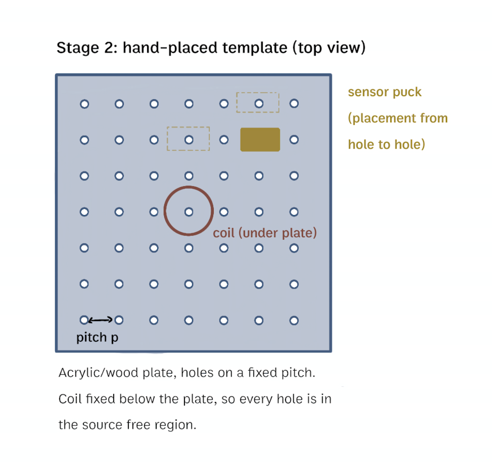

# Lab log

Control K + V to view preview (VS code)

## 2026-11-20: Planning the hardware, gantry is now a real goal
 
Started the mechanical side in parallel with the code since parts take a while to ship. Made the gantry a real goal instead of a stretch, wrote a parts list (`hardware/parts-list.md`) and drew a block diagram + mechanical sketch for the Stage 2 rig and Stage 3 gantry.

- Picked the MLX90393 over the TLV493D. The TLV's ~0.1 mT/step is too coarse, since a small coil only gives ~80 µT at 5 cm.
- Full gantry setup came to ~C$200 (searching on Aliexpress for gantries), so I'm only buying the sensor + board for now. Adafruit shipping to Canada is $17, so planning to look at DigiKey.ca ($12 shipping) for the sensor and checking RidgidWare first for ESP32, cable, nylon screws, and copper wire. A used 3D printer could work as the gantry later.
- Flipping the coil current (+I/−I) and subtracting cancels Earth's field and the gantry's own field. Learned what all the arrows mean (I²C, G-code, GRBL, step/dir) in `docs/learning-notes.md`.
Next: check RidgidWare, order the MLX90393, finish the mechanical sketch, add both diagrams to the README.

## 2026-11-19: First code, Biot-Savart loop simulator & Parts research

Cleared up vector sizes in a layer, read up on Biot-Savart (notes + OpenStax figure in `docs/learning-notes.md`), then built my first real code: a simulator for the field of a single wire loop (`src/pinnfield/biot_savart.py`) with tests in `tests/test_biot_savart.py`.

- In z = Wx + b, b is a vector (1 bias per node). Wx + b is affine, and the activation is deliberately nonlinear, otherwise stacked layers collapse into 1 matrix.
- The simulator chops the loop into 1000 straight pieces and adds up each piece's field. The only exact answer to check against is on the loop's axis, so the tests compare to that.
- All 5 tests pass!: centre field, on-axis Bz, zero sideways field on axis, error shrinking with more pieces, chunking giving the same answer.
- A 5 cm, 1 A loop gives about 12.6 µT at the centre, weaker than Earth's field (~50 µT), which matters for picking a source and sensor in Stage 2. The field blows up on the wire itself, so measurement points have to stay away from the coil, the same rule the PINN needs anyway.

Required! parts to get:
- Adafruit: MLX90393 sensor, ESP32-S3 Dev Board (Check old inventory?), STEMMA QT / Qwiic JST SH 4-Pin Cable
    - OR sensor from DigiKey, Board & Cable from Pishop
- Nylon M3 Screws (Rigidware)
- Small neodymium disc magnets (from Dad)

Next: noise model (sensor noise + probe position error).

## 2026-11-18: How neural networks learn

Watched an intro video on how neural networks learn and reminded me of a polynomial-fitting activity from lin alg (notes in `docs/learning-notes.md`, diagram in `docs/img/`).

- Computing and learning are 2 separate steps. Each layer computes f(Wx + b), then gradient descent nudges W and b downhill on the error.
- The polynomial activity is the same matrix-vector product as a layer, but solved exactly with A⁻¹b.
- To make it a PINN specifically, I mostly change the error: data error + λ × physics error.

Next: 3Blue1Brown chapter 3 (backprop), then start the Biot-Savart generator.
 
## 2026-11-15: Neural networks and Hall sensors
 
Watched 3Blue1Brown's *But what is a neural network?* and read up on Hall sensors (notes in `docs/learning-notes.md`).
 
- A network is one big function. Each layer is a matrix times a vector, plus a bias, through an activation. My PINN needs a smooth activation (tanh or sine), since ReLU's second derivative is zero.
- A Hall sensor reads B from the sideways voltage a field creates in a current-carrying strip. Readings need calibration and background subtraction.
- Seeing my linear algebra class show up was a surprise. It's always felt like pure theory, and seeing it used for something real makes me want to learn more.
Next: 3Blue1Brown chapters 2-3 and the divergence and curl video.
 
## 2026-11-14: Project kickoff
 
Picked the project and wrote the PRD (`docs/PRD.md`) and first README.
 
- Staged plan with go/no-go gates. Stage 1 is simulation only, done by Dec 5-10 before co-op postings open.
- No results yet.
Next: Biot-Savart generator for a single circular coil, checked against the analytic on-axis field.
 